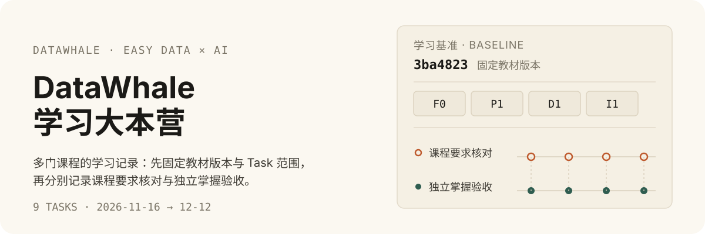

<p align="center">
  
</p>

## 这是什么

DataWhale 课程的个人学习仓库，用于保存笔记、学习证据和实验。首门课程是 [Easy Data × AI](https://github.com/datawhalechina/easy-data-x-ai)，本期共 9 个 Task，2026-11-16 至 2026-12-12。

仓库只跟踪自己的产出。官方教材以独立 Git 仓库克隆在 `easy-data-x-ai/upstream/`，不进入本仓库，克隆后需另行获取。

## 从哪里开始

| 想做的事 | 入口 |
| --- | --- |
| 看本期 Task、章节范围与截止时间 | [课程入口 · Task 索引](easy-data-x-ai/README.md#本期-task-索引) |
| 记录或回顾某个 Task 的笔记 | [easy-data-x-ai/note/](easy-data-x-ai/note/) |
| 查术语的准确含义 | [GLOSSARY.md](GLOSSARY.md) |
| 看正式任务与进度 | [GitHub Issues](https://github.com/Ke2e/datawhale-learning-log/issues) |
| 查已确认的学习方案与审批边界 | [需求与决策记录](.claude/artifacts/designs/datawhale-learning-hub.md) |

## 记录方式：两类结果分开

同一个 Task 有两类独立结论，不合并成一个「通过」：

- **课程要求核对**：这条 Task 的明示要求是否满足。有明确依据才写结论；官方未说明的提交项保留「未核实」。
- **独立掌握验收**：用自己的解释、判断和动手结果证明掌握。课程作业完成但理解仍需补强，是允许的状态。

需要提示才能答对时转入补强，再用新场景或关键变更复验；受助答对的记录不会直接算作独立掌握。术语定义见 [GLOSSARY.md](GLOSSARY.md)。

## 学习方式

默认自学、记笔记、先尝试，再用「事实 → 决策 → 反事实」逐题诊断；卡点按需教学，不提前给完整答案。工程类结论需要实际运行、关键变更和观察结果，口头解释不能替代。

## 仓库结构

```text
DataWhale/
├── easy-data-x-ai/          # 首门课程
│   ├── README.md            # 课程入口与 Task 索引
│   ├── note/task01.md       # Task01 笔记（空白模板）
│   └── upstream/            # 官方教材，独立仓库，不跟踪
├── assets/readme/           # README 视觉素材
├── docs/agents/             # Issue、标签与领域文档约定
├── .claude/artifacts/       # 已确认的学习方案记录
├── GLOSSARY.md
└── AGENTS.md
```

## 工程约定

- **Issue 与正式任务**：GitHub Issues，通过 `gh` CLI 操作，约定见 [issue-tracker.md](docs/agents/issue-tracker.md)。
- **Triage 标签**：五类固定词汇，见 [triage-labels.md](docs/agents/triage-labels.md)。
- **领域文档**：根目录 `GLOSSARY.md` + `docs/adr/`，见 [domain.md](docs/agents/domain.md)。
- **学习方案**：继续课程规划、Task 验收或扩展实验前，先读[需求与决策记录](.claude/artifacts/designs/datawhale-learning-hub.md)。

## 当前状态

课程材料已接入并固定到提交 `3ba4823`，Task01 笔记仍是模板。课程验收、依赖安装和 Issue 创建尚未开始；官方打卡要求尚无依据，继续标为未核实。

## License

[MIT](LICENSE)
